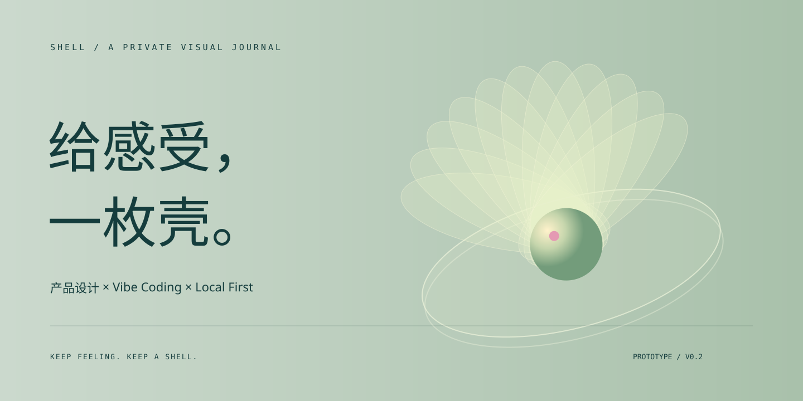
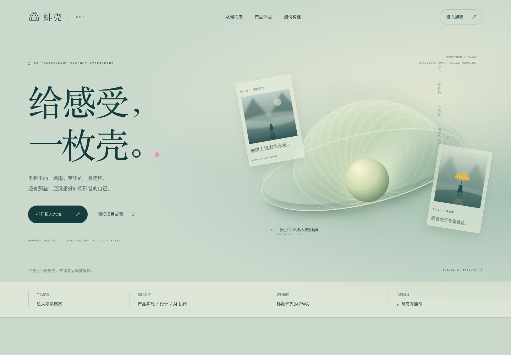
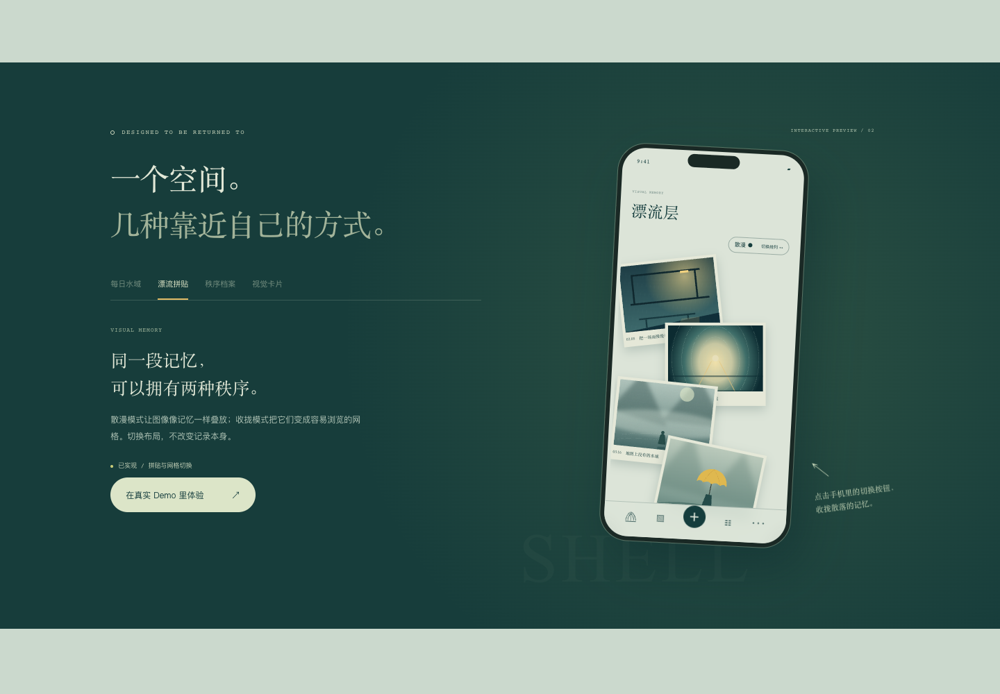

<div align="center">



# 蚌壳 · SHELL

**给电影里的一场雨、梦里的一条走廊，和还没被解释的感受，一枚壳。**

A local-first visual journal, shaped through human intent and AI-assisted development.


[在线项目案例](https://wanner6560-del.github.io/bangke-shell/showcase/) · [体验 Demo](https://wanner6560-del.github.io/bangke-shell/) · [产品方案](docs/PRODUCT.md) · [工程设计](docs/ARCHITECTURE.md) · [项目经历](docs/PORTFOLIO.md) · [English](docs/README.en.md)

</div>

> **状态说明**：核心交互已经实现；AI 旁注、简笔画和相似作品推荐使用预设示例。没有模型调用、云同步或电影截图自动识别。暂无真实用户规模、留存率或商业化数据。

## 为什么做蚌壳

我们把电影画面存进相册，把情绪写进备忘录，把灵感散落在不同软件里。内容都在，却很少再次相遇。蚌壳从这个个人场景出发：让图像、文字和当时的感受留在一起，并且愿意被重新打开。

它面向喜欢电影、写作、摄影和情绪收藏的人，探索三个具体问题：

| 使用中的摩擦 | 产品回应 | 当前交付 |
| --- | --- | --- |
| 截图与“为什么保存”分离 | 一枚图文记录同时保留画面与文字 | 图片导入、记录编辑器、详情页 |
| 灵感随性发生，回看却需要秩序 | 同一组数据支持不同浏览方式 | 拼贴、网格、按保存顺序的档案 |
| 想分享片段，又不想公开全部 | 只从当前摘录生成独立视觉卡 | 1080 × 1440 PNG，支持系统分享时调用 Web Share |
| 记录工具打开后缺少情感吸引力 | 给打开这件事一点仪式感 | 雾中开屏、培养皿、按日期轮换的句子 |

以上为个人使用观察与设计假设，尚未通过系统用户研究验证。

## 看看它如何工作



展示页是独立的产品案例，不依赖登录或 API Key。它包含可切换的手机界面预览、双布局演示、产品决策、工程结构、路线图，以及一键复制的项目经历。



本地启动后访问：

- `/`：可操作的私人视觉档案 Demo。
- `/showcase/`：面向作品集、面试和项目介绍的展示页。

## 功能与边界

| 能力 | 状态 | 实现方式 |
| --- | --- | --- |
| 雾中开屏、培养皿 | 已实现 | CSS / SVG 动效；支持减少动态效果 |
| 每日一句 | 已实现 | 依据本机日期选择内置短句，不调用 AI |
| 本地图文记录 | 已实现 | FileReader + React state + localStorage |
| 拼贴 / 网格 / 档案 | 已实现 | 同一组记录的三种呈现 |
| 视觉卡片 | 已实现 | Canvas 绘制 PNG；下载及可用时的 Web Share |
| 主屏安装与离线访问 | 基础实现 | Manifest + 按访问缓存的 Service Worker；需 HTTPS 或 localhost |
| AI 旁注 / 简笔画 / 推荐 | 展示示例 | 内置文本、SVG 和作品清单，无模型费用 |
| 电影截图识别 | 规划中 | 视觉模型候选 + 影视元数据核验 + 用户确认 |
| 账号、云同步、宠物养成 | 未实现 | 后续按用户反馈决定范围 |

## 快速开始

需要 **Node.js 22.12+** 和 **pnpm 10**。

```bash
pnpm install --frozen-lockfile
pnpm dev
```

打开终端显示的本地地址。手机和电脑在同一局域网时，可用 `pnpm dev --host 0.0.0.0` 预览。

```bash
pnpm check    # 静态检查 + 生产构建
pnpm preview # 预览 dist 构建
pnpm release # 在 releases/ 生成只包含项目文件的发布包
```

## 部署到 GitHub Pages

仓库自带 [验证工作流](.github/workflows/ci.yml) 和 [Pages 工作流](.github/workflows/pages.yml)。在 GitHub 仓库的 Settings → Pages 中选择 **GitHub Actions**，推送到 `main` 后构建并部署。

工作流自动使用仓库子路径构建；用户站点仓库（`username.github.io`）使用根路径。无需外部服务或密钥。

```bash
# 模拟普通项目仓库路径
VITE_BASE_PATH=/bangke-shell/ pnpm build
VITE_BASE_PATH=/bangke-shell/ pnpm preview
```

部署完成后，根路径是 Demo，`/showcase/` 是项目案例。其他静态托管平台可以直接部署 `dist/`；部署在子目录时相应设置 `VITE_BASE_PATH`。

## Vibe coding 在这里做了什么

本项目采用人机协作开发。人提出生活场景、审美关键词、分享和隐私偏好，决定功能优先级；AI 编程助手协助拆解方案、编写界面、实现交互与工程配置。工作重点是把模糊的感受转成可验证的实现：

1. 将“自己的小豆瓣”收敛为“私人视觉档案”，避免一开始就建设社交平台。
2. 将完整独角兽养成降级为培养皿与每日一句，优先打通记录—回看—分享。
3. 用预设示例展示 AI 回声的交互位置，验证价值以后再承担模型费用。
4. 制作公开专用示例，隔离原始日记与未经确认的电影截图。
5. 用实际构建、浏览器验证、子路径部署与文档完成工程交接。

完整经历、面试讲述和验收建议见 [PORTFOLIO.md](docs/PORTFOLIO.md)。

## 工程结构

```text
src/
  App.jsx               私人档案 Demo：记录、浏览、详情与卡片
  App.css               移动端产品视觉
  sample-data.js        虚构演示记录与资源路径
  showcase.jsx          独立产品案例与交互预览
  showcase.css          展示页视觉与响应式规则
showcase/index.html     展示页独立入口
public/
  images/*.svg          原创插画，无外部图片依赖
  sw.js                 同源、限定作用域的离线缓存
docs/                   产品、架构、经历、部署与素材说明
scripts/                发布文件清单与打包脚本
.github/workflows/      CI 与 GitHub Pages
```

## 本地数据与素材

新增记录保存在当前浏览器，不上传服务器。图片使用 data URL，受 localStorage 配额限制；当前没有备份、存储不足提示或跨设备同步，不应把原型当作重要日记的唯一存储位置。旧私人 Demo 的存储键不会被公开版读取。

公开仓库只使用虚构文字和本项目绘制的 SVG。原始私人材料、摄影研究与其他个人文件不会进入发布包。用户自行导入的图片不会因为保存或导出而自动取得版权；请保留适用的署名和授权。

项目目前**不授予通用开源许可**。代码公开供项目展示与评审，复用与分发请先联系仓库维护者；详见 [RIGHTS.md](RIGHTS.md) 和 [素材说明](docs/ASSETS.md)。

已执行的检查和浏览器验收记录见 [VALIDATION.md](docs/VALIDATION.md)。

## 下一步

- [ ] IndexedDB 图片持久化、图片压缩、配额反馈、备份导出。
- [ ] 多记录拼贴布局扩展、日期分组和检索。
- [ ] 移动真机、键盘操作与读屏专项检查。
- [ ] 服务端 AI 代理：按次授权、调用预算和删除机制。
- [ ] 电影候选识别与作品元数据核验，避免把模型猜测当作事实。
- [ ] 用小规模真实试用验证：是否愿意再次打开，能否找回原先的感受。

---

**Keep feeling. Keep a shell.**
