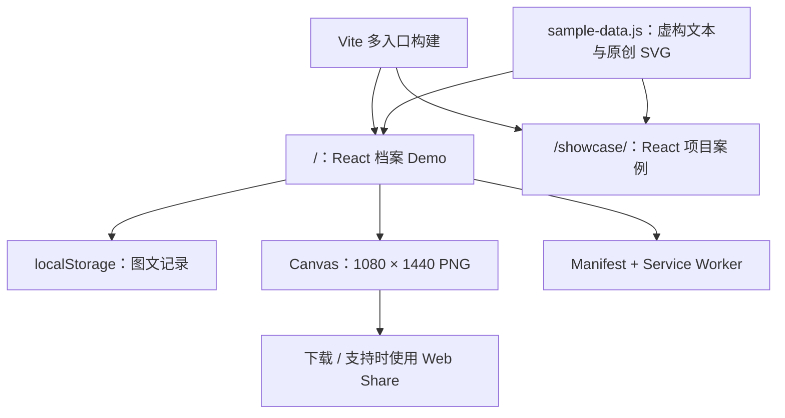

# 工程设计与限制

## 当前架构

两个入口拥有各自的样式和 React 根，不需要路由库。展示页内的手机预览使用独立组件，避免载入私人记录。两者共享公开示例数据与 SVG。

## 数据路径

导入图片由 FileReader 转为 data URL；记录写入 React state，并序列化到 `bangke-public-entries-v2`。公开版不会读取旧键 `shell-entries-v1`，避免旧本机私人内容意外出现在演示中。原键不删除。

当前选择 localStorage 便于原型启动，但其同步写入与小配额不适合大量图片。超额写入时记录仍在当前页面内存中，刷新后可能丢失，尚未向用户提示。下一阶段应迁移到 IndexedDB、压缩图片并实现存储失败反馈与导出备份。

## 分享路径

选择记录 → 取当前摘录 → 加载图片 → Canvas 绘制 → `toBlob` → 下载链接。支持 `navigator.canShare({ files })` 时可尝试系统分享。当前预览与导出均展示摘录；不导出完整正文、标签和旁注。

Canvas 和图片读取失败的反馈、用户取消系统分享的处理仍需要补齐。当前样例 SVG 同源且不含外链；用户导入图片在本地读取，不需要网络权限。

## 构建与部署

Vite 分别输出 `dist/index.html` 与 `dist/showcase/index.html`。JS 中使用 `import.meta.env.BASE_URL` 生成链接；CSS 引用的 public 资源由 Vite 根据 base 重写；Manifest 使用相对路径；Service Worker 以 registration scope 限定缓存范围。

GitHub Pages 工作流计算仓库路径。普通项目使用 `/仓库名/`；用户站点使用 `/`。输出全是静态文件，不依赖服务器路由重写。

## 缓存

Service Worker 只在生产构建注册，预缓存两个页面、Manifest 和图标。资源采用网络优先、缓存回退；只有实际访问过的资源才有离线副本。缓存不等于数据备份，也不保证初次访问时全站离线可用。只接管同源且位于自身 scope 下的 GET 请求。

## 工程选择

| 决策 | 原因 | 代价 |
| --- | --- | --- |
| React + Vite | 快速实现状态交互、静态部署简单 | 尚未拆分为完整领域模块 |
| 原生 CSS / SVG | 风格可控、无需 UI 库或外部图片 CDN | 复杂图像表现需要更多手工设计 |
| 双入口 | 展示案例和产品体验可分别访问 | 有少量预览组件重复 |
| 不接真实模型 | 先验证核心路径，无 Key 与费用门槛 | 无法验证生成质量和延迟 |
| 发布包白名单 | 当前工作目录包含其他个人内容 | 新增文件需更新清单 |

## 上线前与后续检查

仓库 CI 执行 lint 和构建；GitHub Pages 部署独立执行子路径构建。浏览器验收建议覆盖两个入口、320/390/1440px 宽度、功能切换、本地新增后刷新、卡片下载与无浏览器错误。

尚未完成：完整自动化端到端测试、Safari/iOS 真机矩阵、读屏检查、PWA 多设备安装验证。不要把构建成功解释为生产可靠性或无障碍认证。
