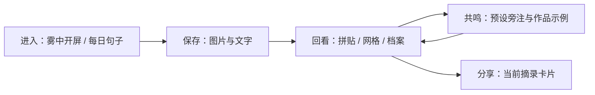

# 蚌壳 · 产品方案

## 产品命题

一个私人空间，能否同时容纳图像、文字和没有被整理好的感受，并让人愿意回来？

蚌壳探索的是“收藏之后的再次相遇”。它面向个人审美与表达，使用手机优先的网页形态，让快速打开、保存与分享进入同一条路径。

## 场景与痛点

个人需求中反复出现三种内容：触动自己的电影画面、片段式日记、梦与创作灵感。相册擅长保存图片，备忘录擅长保存文字，但两者都难以保留画面和感受之间的连接。传统日记的固定列表，也难以呈现非线性灵感。

本项目尚未做系统竞品研究或访谈；下列场景是设计假设，不是已证实的市场结论。

| 场景 | 用户希望做到 | 最小产品回应 |
| --- | --- | --- |
| 看完电影，保存一个瞬间 | 截图旁边带上自己的话 | 导入图片 + 简短文字 |
| 没有写长日记的力气 | 收藏一句话也有价值 | 无必填标题与强制分类 |
| 想随意逛逛自己的记忆 | 用图像而非列表进入 | 自由拼贴与网格 |
| 需要认真寻找一条记录 | 有相对有序的入口 | 按保存顺序的档案视图 |
| 想让别人看到一点自己 | 可分享而不公开整篇 | 当前摘录生成视觉卡 |

## 核心路径

## 范围取舍

**采用 PWA。** 初期希望快速在手机打开，也希望通过链接分发，因此采用一个前端代码库，同时覆盖手机与桌面。在 HTTPS 环境可获得主屏入口和基础缓存；原生应用商店发布暂不纳入。

**养成先收敛成仪式。** 荧光独角兽最初包含沉睡、成长、性格与对话。当前只保留培养皿和日期轮换短句，减少角色动画、对话状态与养成机制的复杂度。每日一句目前来自内置文案，不是实时生成。

**AI 先验证呈现方式。** 当前用预设旁注、SVG 和作品清单观察“如何呈现回声”。后续是否接入模型，需要用使用反馈证明价值；作品信息应通过检索核验。

**分享从视觉卡开始。** 导出图文卡比公开完整日记的权限管理更简单。当前会分享当前摘录的前 74 个字符，用户需要先检查内容；尚未实现单独编辑分享文案和撤销已发送图片。

## 视觉方向

“潮湿的私人标本室”：雾青与深水绿构成环境，雨衣黄与泡泡糖粉构成偶发的亮点；宋体用于情绪文字，黑体用于操作，等宽字用于日期。培养皿和壳形是贯穿原型与项目展示的识别元素。

## 后续 AI 方案

| 能力 | 建议方案 | 主要风险 |
| --- | --- | --- |
| 电影截图识别 | 图片缩放 → 多模态候选 → 影视元数据检索 → 用户确认 | 相似镜头、长尾作品、错误确信 |
| 相似诗歌与电影 | 意象提取 → 可信作品库检索 → 列出匹配理由与来源 | 编造作品或诗句、版权 |
| 简笔画 | 意象结构化 → SVG 模板 / 受约束图像生成 | 风格不稳定、调用成本 |
| 情绪音乐 | 先推荐已存在作品；原创音乐生成单独评估 | 授权、模型延迟、音频成本 |
| 陪伴对话 | 用户选择的文本上下文 + 可删除的短记忆 | 越界推断、长期数据保留 |

API Key 只放服务端。默认不自动分析全量日记；每次调用显示使用内容、可取消、设预算。具体供应商与价格尚未选择，本版无调用费用。

## 如何验证价值

招募少量目标用户完成“导入一张图并写一句话 → 在另一种布局找到它 → 生成分享卡”。观察操作是否顺利、用户是否愿意在之后自发回看、是否理解分享范围。可记录完成率、错误与定性反馈；当前没有这些实测数据。

## 可发布原型的完成标准

提供两个可运行入口、原创公开素材、清晰的功能状态、项目方案与部署说明。生产级完成标准则还需要可靠存储、备份、无障碍专项测试、真实设备检查和用户验证。
